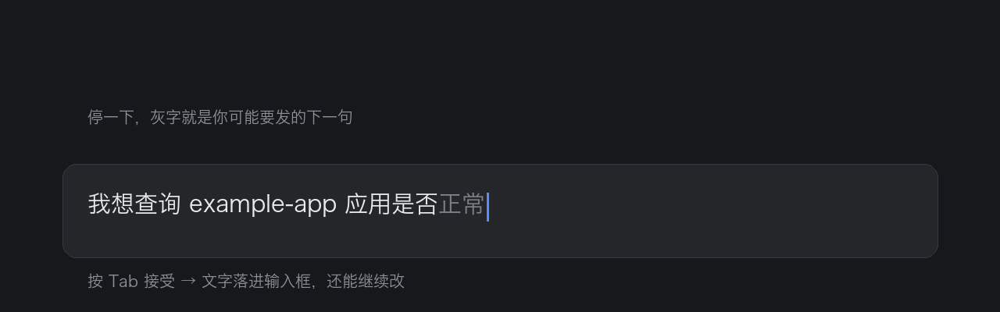
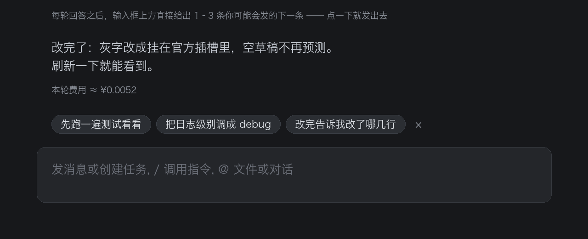

# dsh-input-prediction

在 DSH 的输入框上做两件事：**灰字续写**（Tab 接受）和**回复后推荐**（点一下就发）。





---

## English

A DSH plugin that predicts what you are about to type, using the current conversation and
your own writing style as context.

- **Ghost completion** — while you pause in the composer, the most likely continuation of
  your draft is rendered as grey text behind the caret. Press **Tab** to accept it; the text
  lands in the input box as a normal, undoable edit and you can keep editing.
- **Follow-up suggestions** — after each assistant turn, 1–3 candidate next messages appear
  just above the input box (in the official `conversation.input.dock` slot). Click one to
  send it directly.
- **Settings panel** — Settings → Built-in plugins → “输入预测”: toggle ghost completion,
  toggle suggestions, choose how many suggestions (1–3). Choices are stored in
  `$DSH_HOME/input-prediction.settings.json` and apply immediately.

### Install

```bash
# from the plugin marketplace: Settings → Plugin marketplace → search “input-prediction”
dsh plugin --profile desktop add dsh-input-prediction
# or straight from GitHub
dsh plugin --profile desktop add https://github.com/fishcg/dsh-input-prediction
```

Both halves hot-reload; no build step, no dependencies. Requires DSH `>= 0.2.0-rc.2`.

### Configuration

Everything has a working default. The most common knob: `reasoningEffort` must stay `off`
(a completion is a dozen characters long — reasoning tokens would eat the whole budget and
return empty text). See the Chinese section below for the full config table.

### License

MIT © 2026 fishcg

---

## 它做什么

两件事，都围着输入框转：

1. **灰字补全** —— 在输入框里用灰字补上你接下来最可能打的那句话，按 **Tab** 接受，文字落进输入框，还能继续改。
2. **回复后推荐** —— 每轮回答写完，在输入框**正上方**给 1–3 条你可能要发的下一条，**点一下直接发送**。

```
┌──────────────────────────────────────────────────────────┐
│ 我想查询 example-app 应用是否正常                         │  ← 「正常」是灰字
└──────────────────────────────────────────────────────────┘
   ↑ 你打到这里                ↑ 模型续写的，Tab 一下就到手

        ┌──────────────────────────────────────────┐
        │ 顺便把日志级别调成 debug  然后跑一遍看看   │  ← 点一下直接发送
        └──────────────────────────────────────────┘
┌──────────────────────────────────────────────────────────┐
│ 发消息或创建任务, / 调用指令, @ 文件或对话                  │
└──────────────────────────────────────────────────────────┘
```

- 灰字只画在**光标后面**，不动你的草稿；点推荐**等价于你自己打完按 Enter**（同一条提交链，可撤销地写进草稿再提交）。
- 预测依据是**当前会话上下文** + **你平时说话的口吻**（把你最近几条消息单独喂给模型当样本）。
- Tab 走 DSH 官方的插入通道（`captureInsertion` + `insertText`，带版本守卫），所以是一次**可撤销**的普通编辑，不是替换草稿。
- 拿不准时模型会输出空串——宁可不提示，也不猜一句驴唇不对马嘴的。

## 安装

```bash
# 从插件市场：设置 → 插件市场 → 搜「输入预测」
dsh plugin --profile desktop add dsh-input-prediction          # npm
dsh plugin --profile desktop add https://github.com/fishcg/dsh-input-prediction   # GitHub

# 本地开发（本机就是这样装的）
dsh plugin --profile desktop add link:/Users/fish/dsh-input-prediction
```

插件由两个半区组成：

| 半区 | 文件 | 职责 |
| --- | --- | --- |
| 宿主 | `lib/index.js` | 注册 `/dsh-input-prediction/{hello,predict,suggest,settings,telemetry,transcript}` 路由；从 `sessionQuery` 读会话、调 `llm.stream` 做流式补全、生成推荐候选、读写用户偏好 |
| 客户端 | `lib/client.js` | 找到 composer 的 Lexical 输入框，停顿后请求预测，把灰字画在光标处；回答结束请求推荐并画在输入框上方；接管 Tab；注册「插件设置」里的标签页 |

客户端半区是手写 CJS + 纯 DOM（不 import 任何 `@deepseek-ai` 的值，只经 `exports.inject` 取服务、`require('react')` 取平台 React），零构建。

## 回复后推荐（建议气泡）

- **时机**：这一轮回答**结束之后**（内核 `uiSession.sessionStatus` 的 `running` 从 true 变 false）且草稿为空时请求一次；页面刚打开、草稿为空时也会为最近一轮补一次。
- **回答进行中不出候选**：还在思考、正在跑工具、正在流式输出时，候选（`renderChips()`/`requestChips()` 里的 `turnRunning()`）一律收起、不请求。灰字不受这条限制，见下节。
- **点一下 = 直接发送**：候选按钮 → `setDraft(text)` → 等编辑器投影落地（60ms 轮询，最多 1.5s）→ `submit()`。不成功会记 `client:chip-send-failed`，不会发出空消息。
- **收起**：右下角的 `×` 收起本批（记 `client:chips-dismissed`）；开始打字、正在回答、切换会话也会自动隐藏。
- **一轮一次**：同一「对话版本」只请求一次，结果按 `contextEpoch` 校验，过期结果直接丢弃（不会把上一轮的候选贴到新对话上）。
- 候选文本不超过 `chipMaxChars`（默认 40 字），最多 `chipCount` 条。

## 设置面板

入口：**设置 → 内置插件 → 「输入预测」标签页**（客户端注册到官方槽 `settings.plugins.tab`，`order: 20`）。

| 项 | 默认 | 说明 |
| --- | --- | --- |
| 输入框灰字补全 | 开 | 关掉后不再请求预测、不画灰字、Tab 也不接管 |
| 回复后推荐 | 开 | 关掉后不再请求推荐，已有气泡立即收起 |
| 推荐条数 | 3 | 1 / 2 / 3 分段按钮 |

- 面板里改的值写进 `$DSH_HOME/input-prediction.settings.json`（`settingsFile` 可改路径），**立即生效**，不用刷新页面，也不用重启桌面端。
- 优先级：**用户偏好文件 > patch 里的默认值**。也就是说 `cordis.patch.yml` 里的 `completionEnabled/chipsEnabled/chipCount` 只是「出厂默认」，用户在面板里选过之后以文件为准（删掉那个 json 就回到默认）。
- 写盘是「写 `.tmp` 再 `renameSync`」，不会写坏。

## 怎么确认它在跑

```bash
tail -f /tmp/dsh-input-prediction.log        # 把 debugLog 打开时才有
```

日志按行 JSON，看到这些就说明链路是通的：

| 事件 | 含义 |
| --- | --- |
| `client:ready` | 客户端半区已加载（页面里） |
| `client:host-contact` | 客户端拿到了宿主路由与三个开关 |
| `client:settings-tab` | 设置标签页注册结果（`{ok:true}` = 已挂进「插件设置」） |
| `client:settings-updated` | 用户在面板里改了设置 |
| `client:chips` | 拿到了推荐候选（带 `visible` 与屏幕矩形，能看出有没有真的画出来） |
| `client:chips-failed` / `client:chip-send` / `client:chip-send-failed` | 推荐请求失败 / 点了候选并发送 / 发送没成功 |
| `predict` | 收到一次预测请求（带草稿） |
| `context` / `suggest-context` | 从会话里取了多少条上下文 |
| `stream-done` | 模型这一次的 finish 原因、思考增量、原文 |
| `predict-done` / `suggest-done` | 最终建议 / 推荐候选与耗时 |
| `client:accept` | 用户按了 Tab，`detail.how` 为 `insertText`（官方通道）或 `setDraft`（回退） |
| `settings` / `settings-updated` | 宿主侧读到的偏好与落盘结果 |

页面控制台（如果开着 DevTools）另有一份：`[input-prediction]` 前缀。

## 配置

配置写在 `cordis.patch.yml` 里（或 profile 的 `cordis.patch.yml` 里同 id 覆盖）：

```yaml
- insert:
    - id: dsh-input-prediction
      name: dsh-input-prediction
      config:
        enabled: true
        provider: ''
        model: ''
        reasoningEffort: 'off'
        maxTokens: 160
        temperature: 0.3
        contextMessages: 16
        contextChars: 600
        maxSuggestionChars: 60
        styleHint: ''
        # —— 下面这些是「出厂默认」，用户偏好文件优先 ——
        completionEnabled: true
        chipsEnabled: true
        chipCount: 3
        chipMaxChars: 40
        chipsMaxTokens: 320
        chipsTemperature: 0.7
        settingsFile: ''
        debugLog: ''
```

| 键 | 默认 | 说明 |
| --- | --- | --- |
| `enabled` | `true` | 总开关。`false` 时客户端拿到 `hello` 后直接不工作 |
| `provider` / `model` | `''` | 留空 = 跟随「默认模型」设置（`agent-default-model`） |
| `reasoningEffort` | `off` | `off`/`low`/`high`/`max`，`''` = 跟随 provider。**别改成 high**：修补全是「续写十几个字」，一开思考 `maxTokens` 全被吃光，返回空文本 |
| `maxTokens` | `160` | 灰字建议都很短，够用 |
| `temperature` | `0.3` | 想更放飞就调高 |
| `contextMessages` | `16` | 喂给模型的最近消息条数 |
| `contextChars` | `600` | 单条消息截断长度 |
| `maxSuggestionChars` | `60` | 灰字建议文本上限（超出会被砍） |
| `styleHint` | `''` | 追加到系统提示词的口吻要求，比如「简短、别用问号」 |
| `completionEnabled` | `true` | 出厂默认：灰字补全（面板里可改，改了以文件为准） |
| `chipsEnabled` | `true` | 出厂默认：回复后推荐 |
| `chipCount` | `3` | 出厂默认：推荐条数（夹到 1–3） |
| `chipMaxChars` | `40` | 单条候选的长度上限（夹到 8–120） |
| `chipsMaxTokens` | `320` | 生成候选的 token 预算（夹到 64–1024） |
| `chipsTemperature` | `0.7` | 生成候选的温度（夹到 0–1.5）；比灰字更发散一点 |
| `settingsFile` | `''` | 用户偏好文件路径，空 = `$DSH_HOME/input-prediction.settings.json` |
| `debugLog` | `''` | 诊断日志路径（默认关）；超 1MB 自动清空 |

配置改动要**重新载入一次 patch 层**才生效：动一下 profile 的 `cordis.patch.yml`（保存即触发一次 live reload，已验证会重新读入本插件的 bundle patch），或者重启 DSH 桌面端。

## 交互细节

- **触发（灰字）**：草稿**至少打了一个字**、停顿约 320ms 后发一次预测；相邻请求至少间隔 650ms；切换会话/发送消息/回答结束都会重新评估。
- **回答进行中也预测灰字**：内核 `uiSession.sessionStatus` 的 `running` 为真时（思考、跑工具、流式输出），只要草稿非空就照常预测、照常画——用户打了第一个字就该看到提示，不必等回答写完；草稿为空的那条门禁仍然生效，所以回答期间不会凭空猜「下一条」。`turnRunning()` 拿不到内核状态时退回 `[data-streaming]`。
- **展示（灰字）**：只有「光标在草稿末尾 + 草稿非空 + 输入框已聚焦 + 没开斜杠菜单 + 不在中文输入法组合中 + 建议非空」时才画；灰字宽度超过输入框剩余空间会被裁短——**显示多少就插入多少**。草稿空着时那块地方归占位文案和推荐候选，不画灰字。
- **Tab**：仅当上面这些条件都成立时才被接管（`preventDefault`），否则 Tab 保持原样。斜杠/`@` 菜单打开时 Tab 仍然是「选中菜单项」。
- **切换会话**：`tick()` 发现当前会话变了就 `bumpContext()`——灰字、候选、缓存、上下文版本全部作废，不会把上一个会话的推荐带过来。
- **缓存**：同一「会话 + 上下文版本 + 草稿」60 秒内不重复请求；空结果同样进缓存，所以对着空输入框发呆不会反复问模型；请求失败有 15 秒冷却。
- **上下文版本（`contextEpoch`）**：草稿从非空变空（发出去了）、回答开始/结束、页面重新绑定会话时都会 +1，旧提示与旧候选一并作废。

## 排障

| 现象 | 先看什么 |
| --- | --- |
| 完全没有灰字 | `client:ready` 有没有出现；没有就是客户端 bundle 没加载（重启桌面端 / 硬刷新页面） |
| `client:ready` 有、但从不预测 | `client:host-contact` 是否成功；失败说明路由不可达，或灰字开关被关掉了 |
| `predict` 有、`predict-done` 的 `suggestion` 是空串 | 看同一条 `stream-done` 的 `rawChars`：0 且 `reasoningChars>0` = 思考吃掉了预算（`reasoningEffort` 应为 `off`）；0 且都为 0 = 模型这次选择不说 |
| 回答写完了但没有推荐气泡 | `client:chips` 有没有出现：没出现 = 请求没发（草稿非空/正在回答/开关关了）；出现了但 `visible:false` = 槽位与卡片都不可用（看 `client:chips-dock` 是不是 `{ok:false}`） |
| 气泡和别的面板叠在一起 | `client:chips` 的 `rect` 宽度接近卡片宽度（≈`卡片宽-24`）= 走的是**兜底浮层**，说明 `client:chips-dock` 没注册成功（`slots` 服务不可用） |
| 点了候选没发出去 | `client:chip-send-failed` 的 `reason`：`no input shell` = 拿不到输入壳；`draft not set` = `setDraft` 没落地（在 1.5s 内） |
| 「插件设置」里没有「输入预测」 | `client:settings-tab`：`{ok:false,reason:'slots unavailable'}` = `ctx.get('slots')` 一直拿不到（设置 UI 未加载） |
| 报 `DeepSeek Messages transport failed` | 消息 `content` 必须是**内容块数组**（`[{type:'text',text}]`），传字符串会在 transport 里炸成这个笼统错误 |
| 灰字压在正文上 | 光标矩形退化（Lexical 选区停在块级边界）——`lastCharRect()` 就是为这个兜底的 |

## 开发

两个半区都能**热重载**，不必重启桌面端：

- 客户端：`lib/client.js` 是每次请求现取的（`no-cache`），改完约 1 秒页面就会加载新版本（`client:ready` 会再报一次）。热重载会留下旧实例，所以代码里有「实例卫生」（`INSTANCE_SLOT` 令牌 + `sweepStaleDom()` + `sweepForeignDom()` + `isStale()`），新实例上线时会清掉旧实例画的浮层。
- 宿主：默认不监听模块改动。要让 `lib/index.js` 改完即生效，在 profile 的 `cordis.patch.yml` 里加：

  ```yaml
  - id: hmr
    name: "@deepseek-ai/dsh-hmr"
    config:
      base: /Users/fish/dsh-input-prediction
      root: ["."]
  ```

  它靠 `@deepseek-ai/dsh-hmr` 的 `partialReload()`：插件模块既是改动文件又是入口模块，于是 `apply()` 会重跑。**这台机器上开发完已经删掉了**（profile 里不留开发期配置）；要再改宿主半区，把这段加回去、或者重启一次桌面端即可。

- 安全：所有路由都走同源 + 回环 Host + 宿主信任栅栏（`ctx.connection.requestRejection`），所以**只能从页面里调用**——用 curl 打永远是 `401`（这也正好可以当「路由有没有注册」的探针：`404` = 没注册，`401` = 注册了但被拦）。

## 卸载

```bash
dsh plugin --profile desktop remove dsh-input-prediction
rm -f ~/.dsh/input-prediction.settings.json    # 顺手删掉用户偏好
```

## 已知边界

- 灰字只在**光标位于草稿末尾**时预测；光标在中间时不打扰。
- 灰字一次只预测「紧接着的后续文字」，不做多行/多候选。
- 输入法（IME）组合期间不显示、不接管 Tab。
- 灰字超长时按可用宽度截断显示，Tab 插入的是**截断后**的文本。
- 推荐气泡挂官方槽位 **`conversation.input.dock`**（composer 卡片正上方、卡片外、**占布局**），用一个 5 行的 React 壳（`ChipsDock`）当挂载点，气泡本身仍是命令式 DOM。所以它不会和同位置的面板（genui / btw / 排队条）叠在一起；槽位没挂上时（`slots` 服务拿不到）会退化成自绘浮层，这时才可能重叠。
- 推荐候选只按当前对话生成，不读你的历史会话库。

## License

MIT © 2026 [fishcg](https://github.com/fishcg)
